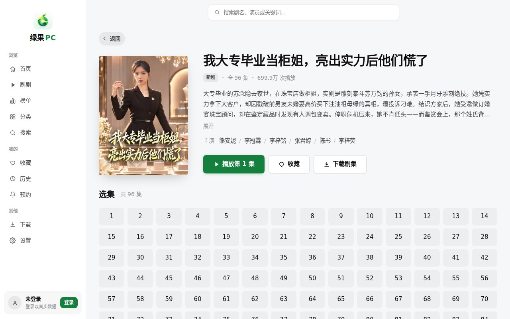
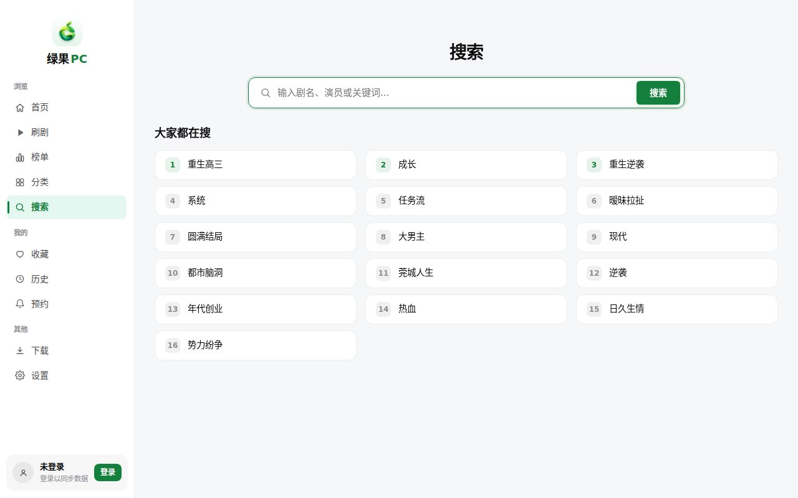
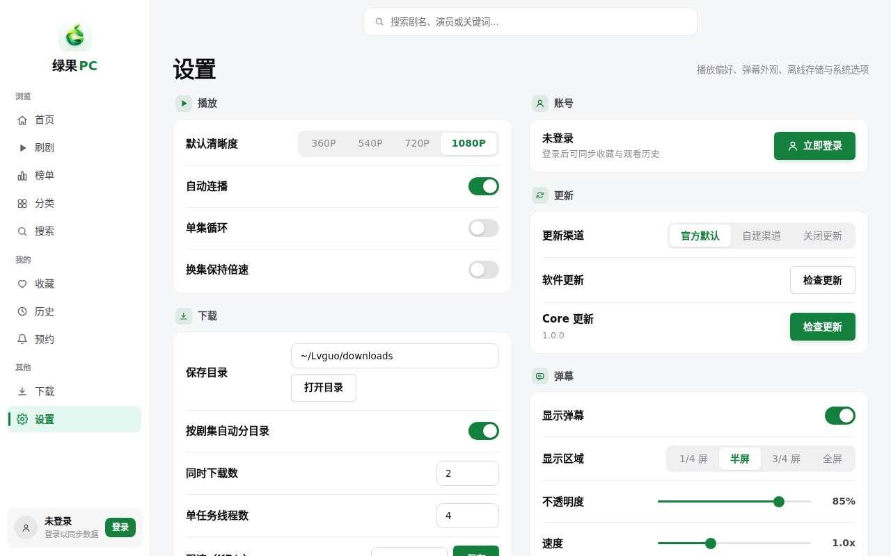
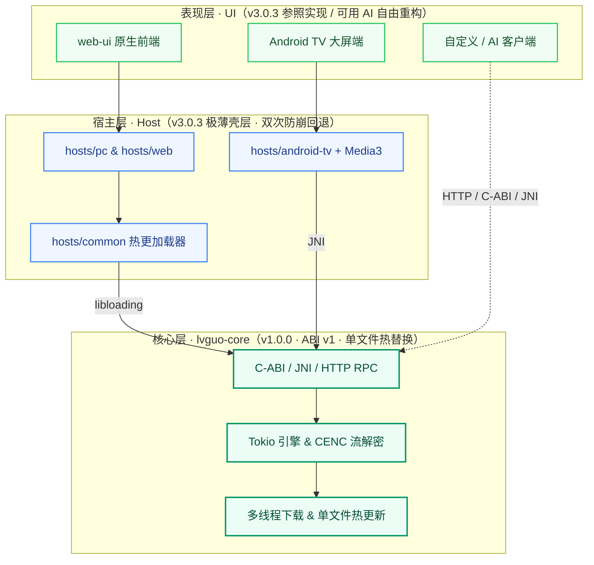

<div align="center">


# 绿果

**用遥控器大屏看剧，用桌面端沉浸追剧，更用单一共享核心自由衍生你自己的客户端。**

核心引擎 **`lvguo-core`（1.0.0 · ABI v1）** × 全端官方宿主与界面发行版（**3.0.3**）

[](https://github.com/Amor5207/lvguo-core/releases/tag/v3.0.3)
[-16a34a?style=flat-square)](sdk/lvguo_core.h)
[](https://github.com/Amor5207/lvguo-core/releases)
[](#下载与安装)
[](#下载与安装)
[](#下载与安装)
[](LICENSE)

[下载 v3.0.3](https://github.com/Amor5207/lvguo-core/releases/tag/v3.0.3) · [Core 与 SDK 发布](https://github.com/Amor5207/lvguo-core/releases) · [功能特性](#功能特性) · [界面预览](#界面预览) · [架构设计](#架构设计) · [SDK 接入与 AI 构建](#sdk-接入与-ai-协同开发) · [构建项目](#构建项目)

<br>


</div>

---

## 简介与维护策略

**绿果 3.0** 彻底重构了原有的多端耦合架构，将请求签名、设备注册、扫码/短信登录、内容检索、CENC 流式解密、多线程断点下载以及热更新逻辑全部收口至单一原生动态库 **`lvguo-core`（v1.0.0）**；全端全面取消邀请码与强制登录限制，打开即可看剧、搜索与 1080p 播放，账号仅用于可选的跨端云同步。

针对不同使用者，项目提供两条明确路径：

- **面向普通用户**：直接下载 **3.0.3 全端通用包**（Android TV APK、Windows 统一安装程序、macOS Universal 镜像或 Linux/Web 包），开箱即用；未来只需在设置中通过**单文件 Core 热更新**即可保持解析与播放可用。
- **面向开发者与 AI 玩家**：直接集成 **`lvguo-core`（v1.0.0）** 提供的 C-ABI、HTTP RPC（`POST /api/call`）或 Android JNI 接口，结合 **AI 编程助手**，在任意语言和界面框架下快速构建完全符合自己交互习惯的客户端。

> **维护范围声明（请务必知悉）**
> - **长期持续维护：`lvguo-core`（v1.0.0 核心引擎）** —— 持续跟进协议适配、请求签名、流媒体解密、下载器优化与稳定性修复，各端通过替换**单个核心动态库文件**即可热升级。
> - **仅修致命 Bug：官方上层 UI（v3.0.3）** —— Android TV、PC 客户端及 Web 前端自 `3.0` 起已稳定定型，**除影响主流程崩溃/不可用的致命 Bug 外，不再进行常规 UI 改版或新增界面功能**。

---

## 功能特性

### Android TV / 投影仪端（v3.0.3）

- **大屏与遥控器原生交互**：针对 `1920×1080` 大屏打造，支持方向键焦点导航、数字键直达选集、长按快进快退，以及免安装**局域网手机扫码遥控**。
- **Media3 硬件解码与低内存流式解密**：`liblvguo_core.so` 在本地回环启动轻量流媒体网关直接供 ExoPlayer / Media3 拉流拖拽，支持多倍速、选季选集、播完自动连播下一季与双路预载。
- **完整观影体验与单包全兼容**：内置实时评论弹幕、观看健康提醒与可选账号云同步；**单个 APK 同时内置 `arm64-v8a` 与 `armeabi-v7a` 双架构核心**，兼容老电视盒子与新款安卓设备。

### PC 桌面客户端 · 绿果PC（v3.0.3）

- **极薄宿主免捆绑大体积内核**：Windows / macOS 优先复用系统 WebView 无边框窗口，Linux 或老系统自动拉起桌面浏览器；安装体积仅数 MB。
- **多线程离线下载与断点续传**：支持整剧或批量选集缓存、HTTP Range 多线程并发下载、全局限速与按剧自动分目录落盘（落盘前完成 CENC 解密）。
- **可选 `mpv` 独立硬解与 GPU 画质增强**：检测到本机安装 [`mpv`](https://mpv.io/) 时解锁独立硬件解码窗口，并在设备 WebGL2/GPU 支持时自动呈现 **CAS 锐化**、**FSR 超分**、**AI 超清（Anime4K）** 与画面补帧开关。

### Web 服务端（v3.0.3）

- **单二进制 + 单动态库开箱运行**：内置统一前端资产表，无任何外部配置文件与前端构建依赖；支持一键注册/卸载 Linux `systemd` 与 Windows 计划任务。
- **桌面影院交互与服务端解密**：内置浅色 / 深色 / 跟随系统主题、即时展开的全局搜索联想框、沉浸式刷剧流、弹窗式选集与评论面板、键盘快捷键，以及服务端实时 CENC 解密流直出。

---

## 界面预览

<table>
  <tr>
    <td width="50%"></td>
    <td width="50%"></td>
  </tr>
  <tr>
    <td align="center"><sub>首页横幅、全局顶部搜索与热播推荐（浅色模式）</sub></td>
    <td align="center"><sub>首页视图（深色模式自适应主题）</sub></td>
  </tr>
  <tr>
    <td width="50%"></td>
    <td width="50%"></td>
  </tr>
  <tr>
    <td align="center"><sub>多维度榜单与频道筛选</sub></td>
    <td align="center"><sub>多标签组合分类筛选</sub></td>
  </tr>
  <tr>
    <td width="50%"></td>
    <td width="50%"></td>
  </tr>
  <tr>
    <td align="center"><sub>剧集详情与分段选集（支持播放、收藏与批量下载）</sub></td>
    <td align="center"><sub>独立搜索页与实时热搜榜</sub></td>
  </tr>
</table>

<p align="center">
  <br>
  <sub>双栏设置中心（独立 Core 热更新渠道切换、画质增强与下载调度配置）</sub>
</p>

---

## 架构设计

整个工程按 **「单一内核 × 极薄宿主 × 可替换界面」** 的三层边界严格拆分：上层与宿主不存放任何接口密钥、签名算法或解密逻辑；底层仅暴露稳定契约，不耦合任何 UI 渲染框架。



### Core 内部关键链路与机制

1. **实时 CENC 流式解密网关（不落盘）**：
   - 上层播放器向 `media_server.rs` 发起带 `Range` 头的本地 HTTP 请求（`/media/:vid.mp4`）；
   - `runtime.rs` 协同 `upstream/` 与 `sign/` 解析清晰度与播放密钥，`cenc/` 模块在内存中按采样偏移对视频分段进行逐块即时解密并透传响应，**播放过程不在磁盘残留明文或密文视频缓存**；支持任意时间点拖拽（Seek）。
2. **插槽式单文件热更新 + `.attempt` 双次防崩回退**：
   - **严格单文件**：`<dataDir>/core_hot/` 目录内只允许存在当前平台对应的唯一目标动态库（Windows: `lvguo_core.dll`；Linux/Android: `liblvguo_core.so`；macOS: `liblvguo_core.dylib`），绝不引入外部 JSON/DEX 策略文件；
   - **三重校验**：`updater.rs` 下载后依次校验 **SHA-256**、目标平台二进制魔数（ELF / PE / Mach-O）及 `abiVersion`（当前为 `1`），原子替换落盘；
   - **自动兜底回退**：宿主（`hosts/common` / `CoreLoader`）加载热更库前先写入瞬态 `.attempt` 标记，待 `lvguo_init` / `nativeInit` 健康返回后立即清除；若连续两次未能顺利完成初始化，宿主自动销毁异常热更文件并回退到内置基线库。详细协议见 [`sdk/UPDATE_SPEC.md`](./sdk/UPDATE_SPEC.md)。
3. **三档更新渠道与能力协商**：
   - 更新模式支持 `default`（官方源）、`custom`（任意自建静态 Manifest JSON 或动态服务端）与 `disabled`（纯离线）；
   - Web 前端启动后先查询 `GET /api/capabilities`，按宿主返回值动态启用离线下载管理、独立原生播放器及着色器开关。

### 仓库结构与版本对应关系

| 目录 / 文件 | 版本 | 职责说明 |
| --- | --- | --- |
| [`core/`](./core) | `1.0.0` | 核心共享动态库（`cdylib` + `rlib`），内部含 `cenc/`、`sign/`、`upstream/`、`runtime.rs`、`media_server.rs`、`downloader.rs`、`http_server.rs`、`updater.rs`、`jni_bridge.rs`、`limiter.rs` 等模块。 |
| [`hosts/common/`](./hosts/common) | `3.0.3` | PC 与 Web 共用加载器：负责单文件热更查找、ABI 验证、`.attempt` 回退与内嵌 `web-ui/` 资产查找表。 |
| [`hosts/pc/`](./hosts/pc) | `3.0.3` | 桌面宿主：启动无边框 WebView 或本地浏览器，注册原生播放器回调以联动本地 `mpv` 与着色器参数。 |
| [`hosts/web/`](./hosts/web) | `3.0.3` | 极薄 Web 服务端宿主：托管统一前端并支持一键 `service install|status|uninstall` 系统服务托管。 |
| [`hosts/android-tv/`](./hosts/android-tv) | `3.0.3` | Android TV 原生宿主与大屏 UI（含 Media3 播放器、局域网手机遥控服务及双架构打包脚本 [`build_apk.py`](./hosts/android-tv/build_apk.py)）。 |
| [`web-ui/`](./web-ui) | `3.0.3` | PC 与 Web 共享的原生 HTML/CSS/JS 前端与着色器实现（[`gpu_fx.js`](./web-ui/shared/gpu_fx.js)）。 |
| [`sdk/`](./sdk) | `ABI v1` | 公开头文件 [`sdk/lvguo_core.h`](./sdk/lvguo_core.h)、全量接口文档 [`sdk/API_SPEC.md`](./sdk/API_SPEC.md)、热更新规范 [`sdk/UPDATE_SPEC.md`](./sdk/UPDATE_SPEC.md)。 |
| [`packaging/`](./packaging) | `3.0.3` | Windows Inno Setup 统一安装脚本、macOS Universal `.dmg` 脚本与 Linux `.deb` 打包脚本。 |

---

## SDK 接入与 AI 协同开发

`lvguo-core` 在二进制层面暴露**三套等价接入方式**，所有业务能力统一通过 Action 字符串 + JSON 驱动。完整参数与返回值规范请查阅 [`sdk/API_SPEC.md`](./sdk/API_SPEC.md)。

### 核心 Action 速查（一次闭环）

| 分类 | 常用 Actions | 用途 |
| --- | --- | --- |
| 系统与热更 | `core.info` · `core.update.status` · `core.update.channel` · `core.update.check` · `core.update.rollback` | 查询本地端口/版本/平台标识、切换自建更新源与执行单文件热更 |
| 浏览与检索 | `home` · `foryou` · `rank` · `category.options` · `category.list` · `search` · `suggest` | 首页流、推荐流、榜单、多维组合筛选、搜索与联想词 |
| 详情与播放 | `detail` · `seasons` · `comments` · `play` | 获取剧集与分季目录、真实评论弹幕源、1080p 本地解密流地址 `mediaUrl` |
| 账号云同步（可选） | `me` · `login.qr.start` / `poll` · `login.phone.send` / `login` / `verify` · `history.*` · `favorite.*` · `reservation.*` · `progress.report` | 扫码或验证码登录、个人收藏/历史/预约与播放进度上报 |
| 离线下载 | `download.add` · `download.add_batch` · `download.list` · `download.action` · `download.delete_batch` · `download.settings.get` / `set` · `download.local` | 多线程分段下载控制、本地已缓存路径查询 |

### 方式一：本地 HTTP RPC（`POST /api/call` + `/media/:vid.mp4`）

直接运行核心服务进程（如 `lvguo-web --listen 127.0.0.1:8780` 或 `lvguo-pc --headless --listen 127.0.0.1:8780`），任意语言只需发起标准 HTTP POST 请求即可完成全流程调用：

```bash
# 1. 搜索剧集
curl -s -X POST http://127.0.0.1:8780/api/call \
  -H 'Content-Type: application/json' \
  -d '{"action":"search","params":{"q":"逆袭","page":1}}'

# 2. 获取某部剧的全部剧集 vid
curl -s -X POST http://127.0.0.1:8780/api/call \
  -H 'Content-Type: application/json' \
  -d '{"action":"detail","params":{"id":"<series_id>","lite":true}}'

# 3. 解析单集解密播放地址（返回 data.mediaUrl，如 /media/<vid>.mp4?...，支持 Range 拖拽）
curl -s -X POST http://127.0.0.1:8780/api/call \
  -H 'Content-Type: application/json' \
  -d '{"action":"play","params":{"vid":"<episode_vid>","q":"1080p"}}'
```

在浏览器前端或 Node/Bun/Deno 中调用同等简洁：

```js
async function callCore(action, params = {}) {
  const res = await fetch('http://127.0.0.1:8780/api/call', {
    method: 'POST',
    headers: { 'Content-Type': 'application/json' },
    body: JSON.stringify({ action, params }),
  });
  const json = await res.json();
  if (!json.ok) throw new Error(json.error || 'Core call failed');
  return json.data;
}
```

### 方式二：C-ABI 动态库嵌入（[`sdk/lvguo_core.h`](./sdk/lvguo_core.h)）

适合 C/C++、Python、Go、Rust、C#、Electron、Tauri、Qt、Flutter 等原生宿主直接加载 `.so` / `.dll` / `.dylib`。所有导出接口共 **9 个函数**：

| 函数 | 职责说明 |
| --- | --- |
| `uint32_t lvguo_core_abi_version(void)` | 返回 C-ABI 主版本号（当前 `1`），热更新加载后须核对一致 |
| `const char *lvguo_core_version(void)` | 返回 Core 语义版本字符串（静态只读内存，不可 `lvguo_free`） |
| `char *lvguo_init(const char *config_json)` | 初始化全局运行时（`dataDir` / `hostKind` / `updateMode` / `customUpdateUrl`） |
| `char *lvguo_call(const char *action, const char *params_json)` | 同步调用任意 Core Action，返回 `{"ok":true,"data":...}` JSON |
| `char *lvguo_start_http(const char *bind_addr, const char *static_dir, const char *caps_json)` | 启动内嵌 HTTP API、`/media/:vid.mp4` 网关及静态资源托管 |
| `int lvguo_register_asset_provider(LvguoAssetCallback cb)` | 注册内存嵌入式前端资源查找回调（可选，无散落文件部署） |
| `int lvguo_register_native_player(LvguoNativePlayCallback cb)` | 注册宿主原生播放器回调（可选，联动 `mpv` 等本地播放器） |
| `void lvguo_shutdown(void)` | 优雅关闭 Tokio 运行时、媒体服务与下载调度器 |
| `void lvguo_free(char *ptr)` | 释放 `lvguo_init` / `lvguo_call` / `lvguo_start_http` 返回的堆字符串 |

**Python `ctypes` 最小接入示例**（无需编译器，直接运行动态库）：

```python
import ctypes, json

lib = ctypes.CDLL("./liblvguo_core.so")  # Windows: lvguo_core.dll | macOS: liblvguo_core.dylib
lib.lvguo_core_abi_version.restype = ctypes.c_uint32
lib.lvguo_init.argtypes = [ctypes.c_char_p]
lib.lvguo_init.restype = ctypes.c_void_p
lib.lvguo_call.argtypes = [ctypes.c_char_p, ctypes.c_char_p]
lib.lvguo_call.restype = ctypes.c_void_p
lib.lvguo_free.argtypes = [ctypes.c_void_p]

def call_core(func, *args):
    ptr = func(*(a.encode("utf-8") for a in args))
    try:
        return json.loads(ctypes.cast(ptr, ctypes.c_char_p).value.decode("utf-8"))
    finally:
        lib.lvguo_free(ptr)

assert lib.lvguo_core_abi_version() == 1
print("INIT:", call_core(lib.lvguo_init, json.dumps({"dataDir": "./lvguo-data", "hostKind": "python"})))
print("HOME:", call_core(lib.lvguo_call, "home", "{}"))
lib.lvguo_shutdown()
```

### 方式三：Android JNI（内置于 `liblvguo_core.so`）

Android 应用只需将 `liblvguo_core.so` 置于对应 ABI 目录并通过 `ink.pengfei.lvguo.core.CoreBridge` 调用 5 个原生静态方法即可，Java/Kotlin 层零签名、零解密实现：

- `public static native int nativeAbiVersion();`
- `public static native String nativeVersion();`
- `public static native String nativeInit(String configJson);`
- `public static native String nativeCall(String action, String paramsJson);`
- `public static native void nativeShutdown();`

### 借助 `lvguo-core` + AI 快速构建个人专属客户端

因为最耗时、易变的协议层和流媒体解密层已全部稳定封装在 `lvguo-core` 中，你可以直接让 **AI 编程工具**按自己的习惯和审美从零搭建专属客户端（桌面极简播放器、终端 TUI、React/Vue 私人站点、原生 SwiftUI / WinUI 3 / Flutter 客户端等）：

1. 从 [Releases](https://github.com/Amor5207/lvguo-core/releases) 下载目标平台的 `lvguo-core` 动态库（或直接使用 `lvguo-web` 作为本地无头后端服务）；
2. 将仓库中的 [`sdk/lvguo_core.h`](./sdk/lvguo_core.h)、[`sdk/API_SPEC.md`](./sdk/API_SPEC.md) 和 [`sdk/UPDATE_SPEC.md`](./sdk/UPDATE_SPEC.md) 三个文件交给 AI 作为上下文；
3. 直接参考下方 Prompt 向 AI 提问：

> **可复制给 AI 的实战 Prompt 模板**：
> 「请先完整阅读 `sdk/lvguo_core.h`、`sdk/API_SPEC.md` 与 `sdk/UPDATE_SPEC.md`。我想用 **[你指定的框架，例如 Tauri + React / SwiftUI / PySide6 / Flutter]** 做一个完全符合我习惯的短剧客户端：
> 1. 宿主加载同目录下的 `lvguo-core`（优先读取 `<dataDir>/core_hot/` 并实现 `.attempt` 防崩回退 + `abiVersion == 1` 校验），初始化后调用 `lvguo_start_http("127.0.0.1:0", ...)` 或直接通过 `lvguo_call` 调用；
> 2. UI 只需包含 **[你想要的功能：例如首页推荐、全局快捷键搜索、右栏选集与 1080p 播放器、历史记录本地同步、设置里的一键 `core.update.check` 热更新]**；
> 3. 请保持界面层与业务逻辑解耦，所有接口只通过 `POST /api/call` 与 `/media/:vid.mp4` 完成，不得写死任何上游域名或签名逻辑。」

---

## 版本信息

| 项目 | 数值 | 说明 |
| --- | --- | --- |
| 核心引擎 **`lvguo-core`** | `1.0.0`（`ABI v1`） | 持续维护版本；通过 `core-v*` Tag 独立分发单文件动态库与 SDK |
| **Android TV / PC / Web 宿主与前端** | `3.0.3`（内部版本号 `3003`） | 官方参照版；除致命 Bug 外不再更新 UI（通过 `v*` Tag 发布） |
| Android 应用包名 | `ink.pengfei.lvguo` | minSdk 23（Android 6.0+）/ targetSdk 28 |

---

## 下载与安装

### 客户端与服务端通用包（v3.0.3）

从 [v3.0.3 Release](https://github.com/Amor5207/lvguo-core/releases/tag/v3.0.3) 按系统下载对应压缩包（全部采用 `.zip` / `.tar.gz` 打包以避开浏览器拦截，内含安装程序/二进制与 `使用说明.txt`）：

| 文件名 | 适用平台与架构 | 说明 |
| --- | --- | --- |
| `LvguoTV-3.0.3.zip` | Android 6.0+ 电视 / 投影仪 / 手机 | 内含 **64/32 位通用单包** `LvguoTV-3.0.3.apk`（`arm64-v8a` + `armeabi-v7a`）与 `使用说明.txt` |
| `LvguoPC-3.0.3-win.zip` | Windows 64 位 / 32 位（Win7+） | 内含**统一安装程序** `LvguoPC-Setup-3.0.3-win.exe`（自动识别系统位数）与 `使用说明.txt` |
| `LvguoPC-3.0.3-macOS.zip` | macOS（Apple Silicon M 系 + Intel） | 内含 **Universal 通用镜像** `LvguoPC-3.0.3-macOS.dmg` 与 `使用说明.txt` |
| `lvguo-web-3.0.3-macos.tar.gz` | macOS Web 服务端 | 内含 Universal `lvguo-web` + `liblvguo_core.dylib` + `使用说明.txt` |
| `lvguo-web-3.0.3-windows-x64.zip` / `x86.zip` | Windows Web 服务端 | 按 64/32 位区分，内含 `lvguo-web.exe` + `lvguo_core.dll` + `使用说明.txt` |
| `LvguoPC-3.0.3-linux-{amd64,i386,arm64,armhf}.tar.gz` | Debian / Ubuntu 等桌面环境 | 内含对应架构 `.deb` 安装包与 `使用说明.txt` |
| `lvguo-web-3.0.3-linux-{amd64,i386,arm64,armhf}.tar.gz` | Linux Web 服务端 | 内含 `lvguo-web` + `liblvguo_core.so` + `使用说明.txt`，支持 `systemd` |

### 命令行参数与环境变量

- **桌面端 `lvguo-pc`**：支持 `--listen 127.0.0.1:0`、`--data-dir PATH`、`--update-mode default|custom|disabled`、`--update-url URL`、`--browser`（强制浏览器窗口模式）、`--headless`（仅启动本地 HTTP 服务，不拉起界面）。
- **服务端 `lvguo-web`**：支持 `--listen IP:PORT`、`--host IP`、`--port PORT`、`--data-dir PATH`、`--update-mode default|custom|disabled`、`--update-url URL`、`--core PATH`（指定外部动态库路径）；支持环境变量 `LVGUO_HOST`、`LVGUO_PORT`、`LVGUO_LISTEN`、`LVGUO_DATA_DIR`、`LVGUO_UPDATE_MODE`、`LVGUO_UPDATE_URL`、`LVGUO_CORE_PATH`。

```bash
# 示例：Linux 上快速启动并托管后台 Web 服务
tar -xzf lvguo-web-3.0.3-linux-amd64.tar.gz
./lvguo-web --listen 0.0.0.0:8780 --data-dir /var/lib/lvguo
sudo ./lvguo-web service install --listen 0.0.0.0:8780
```

### Core 独立动态库与 SDK（`core-v*`）

自建客户端或单文件升级可在 [GitHub Releases](https://github.com/Amor5207/lvguo-core/releases) 按 `core-v*` 标签获取：
- 各平台单文件二进制：`lvguo-core-{android,windows,linux,macos}-*.{so,dll,dylib}`
- C-ABI 头文件与热更清单：`lvguo_core.h`、`core-manifest.json`

---

## 构建项目

### 编译 Core 与 PC / Web 宿主（需 Rust 1.75+ / Node.js）

```bash
# 1. 语法检查、Clippy 零警告检查与单元测试
node -c web-ui/shared/compat.js && node -c web-ui/shared/core.js && node -c web-ui/shared/icons.js && node -c web-ui/shared/gpu_fx.js && node -c web-ui/pc/app.js
RUSTFLAGS="-D warnings" cargo clippy --workspace --all-targets -- -D warnings
cargo test --workspace

# 2. 编译 Release 核心动态库与宿主程序
cargo build --workspace --release
```

### 构建 Android TV 通用 APK（同时内置 `arm64-v8a` + `armeabi-v7a`）

需预先交叉编译 `aarch64-linux-android` 与 `armv7-linux-androideabi` 的 `liblvguo_core.so` 并配置 Android SDK（直接调用 `aapt2` / `javac` / `d8` / `zipalign` / `apksigner`，不依赖 Gradle 缓存）：

```bash
python3 hosts/android-tv/build_apk.py \
  --version-name 3.0.3 \
  --version-code 3000 \
  --out dist/LvguoTV-3.0.3.apk
```

---

## 使用声明

本项目仅供个人学习与技术研究使用，与红果短剧及其关联公司无关，未获其任何授权或背书。项目本身不提供、不存储、不分发任何视频内容，所有媒体资源与内容版权归原权利人所有。账号登录凭证仅由使用者本地持有，可随时退出或清除。

## 开源协议

本项目代码采用 [GNU General Public License v3.0](LICENSE) 开源协议分发；第三方依赖授权声明见各自 `LICENSE` / `THIRD_PARTY_NOTICES.md`。

## Star History

<a href="https://www.star-history.com/#Amor5207/lvguo-core&Date">
 <picture>
   <source media="(prefers-color-scheme: dark)" srcset="https://api.star-history.com/svg?repos=Amor5207/lvguo-core&type=Date&theme=dark" />
   <source media="(prefers-color-scheme: light)" srcset="https://api.star-history.com/svg?repos=Amor5207/lvguo-core&type=Date" />
   
 </picture>
</a>
